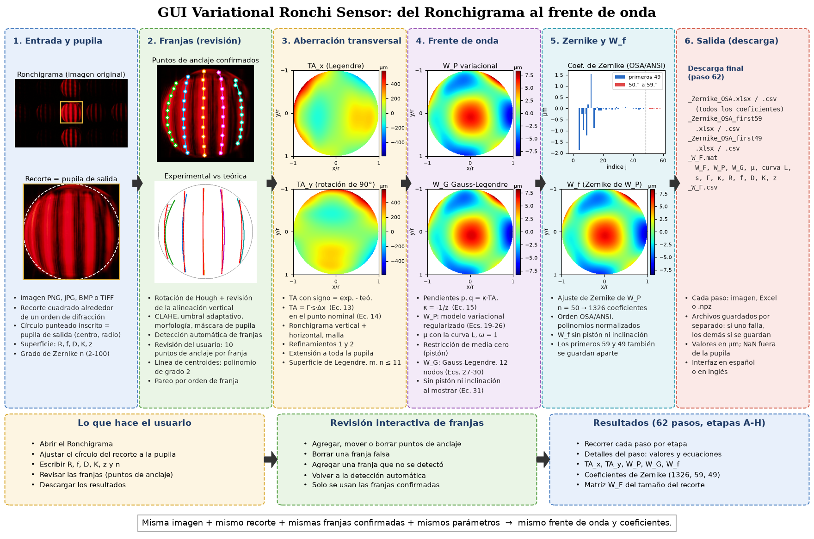
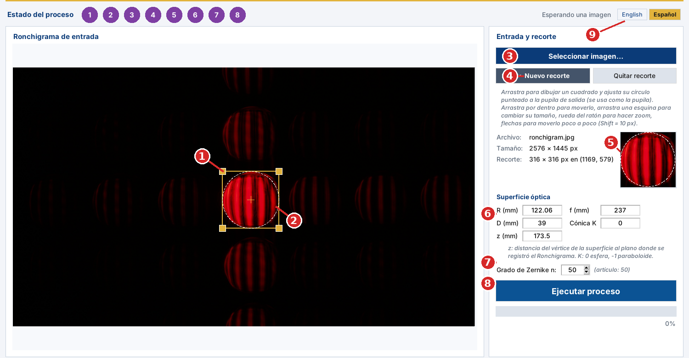
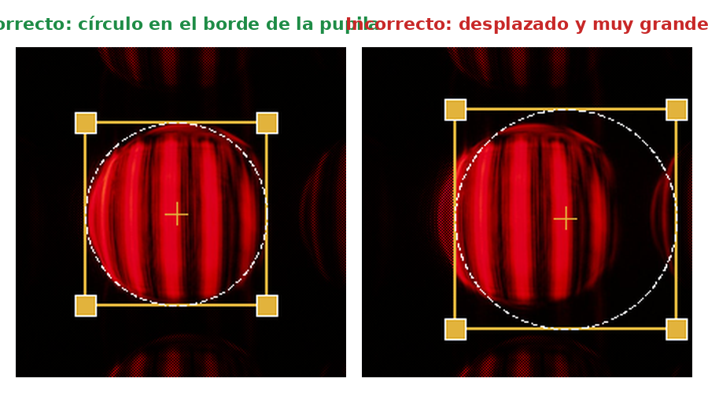
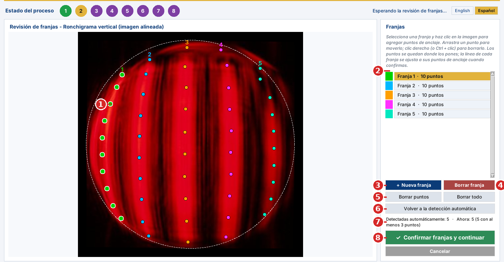
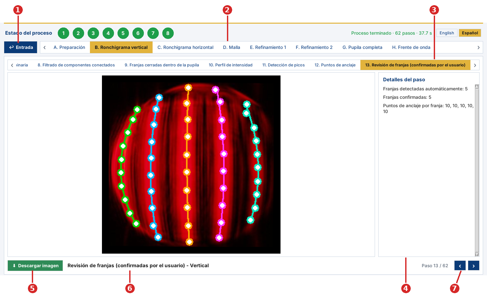
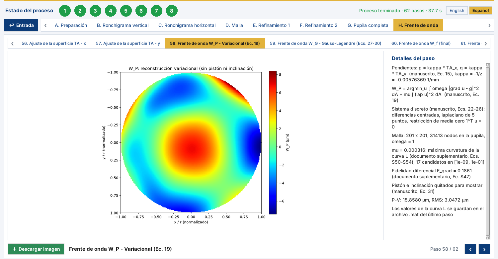

# Variational Ronchi Sensor

[English](README.md) | **Español**

Aplicación gráfica para procesar Ronchigramas, estimar aberraciones transversales, reconstruir el frente de onda óptico y exportar coeficientes de Zernike y matrices del frente de onda en toda la pupila.

El software implementa el procesamiento computacional descrito en el artículo que lo acompaña. Ofrece un flujo de trabajo interactivo para seleccionar la pupila de salida, detectar y revisar las franjas, comparar los Ronchigramas experimental y teórico, refinar las nubes de puntos de aberración transversal y reconstruir el frente de onda con un modelo variacional regularizado y un ajuste de Zernike en orden OSA/ANSI.

> **Aviso de software de investigación**  
> Este repositorio contiene software asociado a una publicación científica. Si lo usas en un trabajo académico, cita el artículo y la versión del software. Agrega la cita final y el DOI en la sección [Cita](#cita) cuando estén disponibles.

## Características principales

- Interfaz gráfica de escritorio escrita en Python con Tkinter.
- Acepta Ronchigramas en PNG, JPEG, BMP y TIFF.
- Recorte cuadrado interactivo cuyo círculo inscrito define la pupila de salida.
- Selección automática y normalización del contraste del canal de la imagen que lleva las franjas.
- Alineación automática de las franjas: transformada de Hough seguida de una revisión de las franjas centrales.
- Segmentación adaptativa de las franjas para iluminación no uniforme de la pupila.
- Detección automática de las franjas a partir de los picos del perfil por columnas.
- Revisión interactiva de las franjas: agregar, mover y borrar puntos de anclaje y franjas.
- Correspondencia entre franjas experimentales y teóricas por orden de difracción.
- Estimación de la aberración transversal en dos direcciones ortogonales.
- Construcción de una malla con las intersecciones de las líneas de centroides experimentales y teóricas.
- Interpolación en dos etapas y refinamiento de las nubes de puntos.
- Extensión de las cantidades reconstruidas a toda la pupila de salida, identificando los puntos medidos y los extrapolados.
- Reconstrucción del frente de onda con un modelo variacional regularizado (`W_P`) y una integración complementaria de Gauss-Legendre por trayectorias (`W_G`).
- Ajuste de Zernike en orden OSA/ANSI, con grado máximo elegido por el usuario entre 2 y 100.
- Exportación de figuras intermedias, tablas, nubes de puntos, matrices, coeficientes de Zernike y productos del frente de onda.
- Procesamiento en segundo plano, para que la interfaz siga respondiendo durante una corrida.

## Resumen del proceso



*Flujo de trabajo de la GUI, del Ronchigrama original al frente de onda. Las imágenes y los mapas salen de una corrida del programa con el Ronchigrama de la columna 1. El usuario interviene en dos lugares: el recorte que define la pupila de salida (columna 1) y la revisión de franjas (columna 2). Todo lo demás es automático.*

Una corrida completa tiene 62 pasos de procesamiento y de salida, agrupados en ocho etapas:

| Etapa | Pasos | Operación principal | Resultado principal |
|---|---:|---|---|
| A. Preparación | 1-5 | Orientación, definición de la pupila de salida y parámetros ópticos | Ronchigrama alineado verticalmente y centrado en la pupila |
| B. Ronchigrama vertical | 6-19 | Segmentación, detección y revisión de franjas, líneas de centroides, referencia teórica | Aberración transversal en x |
| C. Ronchigrama horizontal | 20-33 | Análisis después de una rotación exacta de 90 grados | Aberración transversal en y |
| D. Malla | 34-38 | Intersecciones de las dos familias de líneas de centroides | Desplazamientos dx y dy |
| E. Refinamiento 1 | 39-41 | Primera pasada de interpolación | Nubes de puntos refinadas |
| F. Refinamiento 2 | 42-48 | Segunda pasada de interpolación | Nubes de puntos densas |
| G. Pupila completa | 49-55 | Extensión fuera de la región medida | Campos de aberración transversal en toda la pupila |
| H. Frente de onda | 56-62 | Ajuste de superficies, reconstrucción variacional (`W_P`) y de Gauss-Legendre (`W_G`), y descomposición de Zernike | `W_P`, `W_G`, el frente de onda ajustado `W_f` y los coeficientes de Zernike |

## Requisitos

### Entorno

La aplicación funciona como programa de escritorio en Windows y en macOS (procesadores Apple e Intel). Los ejecutables listos para usar de los dos sistemas se generan automáticamente (ver [Ejecutables (Windows y macOS)](#ejecutables-windows-y-macos)). El código en Python también puede correr en otros sistemas que tengan Tkinter y los paquetes científicos necesarios.

Configuración recomendada:

- Python 3.10 o más reciente
- Una instalación de Tk que funcione
- Al menos 8 GB de RAM para imágenes típicas
- Más memoria y tiempo de procesamiento para recortes grandes o grados de Zernike altos

### Dependencias de Python

El código importa los siguientes paquetes externos:

- `numpy`
- `scipy`
- `pandas`
- `matplotlib`
- `opencv-python`
- `Pillow`
- `openpyxl` para exportar a Excel

Tkinter viene con la distribución estándar de Python en Windows y con los instaladores de macOS de [python.org](https://www.python.org/downloads/macos/). Con el Python de Homebrew en macOS hay que instalarlo aparte (`brew install python-tk`). En algunas distribuciones de Linux hay que instalarlo aparte con el gestor de paquetes del sistema.

## Instalación

### 1. Clonar el repositorio

```bash
git clone https://github.com/<OWNER>/<REPOSITORY>.git
cd <REPOSITORY>
```

Cambia `<OWNER>` y `<REPOSITORY>` por el usuario u organización de GitHub y el nombre final del repositorio.

### 2. Crear un entorno virtual

En Windows PowerShell:

```powershell
python -m venv .venv
.\.venv\Scripts\Activate.ps1
```

En Linux o macOS:

```bash
python3 -m venv .venv
source .venv/bin/activate
```

### 3. Instalar las dependencias

```bash
python -m pip install --upgrade pip
python -m pip install numpy scipy pandas matplotlib opencv-python Pillow openpyxl
```

También puedes crear un archivo `requirements.txt` con:

```text
numpy
scipy
pandas
matplotlib
opencv-python
Pillow
openpyxl
```

e instalarlo con:

```bash
python -m pip install -r requirements.txt
```

## Abrir la aplicación

Hay tres formas de abrir el programa. Los ejecutables no necesitan tener Python instalado.

**Ejecutable de Windows.** Haz doble clic en `VariationalRonchiSensor.exe`. La primera vez puede tardar unos segundos en abrir mientras el ejecutable se descomprime.

**Aplicación de macOS.** Descomprime `VariationalRonchiSensor-macOS-AppleSilicon.zip` (procesadores Apple M1, M2, M3, M4…) o `VariationalRonchiSensor-macOS-Intel.zip` (procesadores Intel) y abre `VariationalRonchiSensor.app`. La primera vez, macOS la bloquea porque no está firmada por Apple; ver [Abrir la app en macOS](#abrir-la-app-en-macos).

**Código en Python.** Desde la carpeta del repositorio, ejecuta (en macOS, usa `python3`):

```bash
python Ronchi.py
```

La GUI puede mostrar tres logos institucionales. Están en la carpeta `img` del repositorio:

```text
img/UNAM.png
img/UASLPlogo.png
img/INAOE.jpg
```

El programa los busca en la carpeta `img` y también junto a `Ronchi.py` (o junto al ejecutable, o dentro de él cuando se incluyen con PyInstaller). Si falta un logo, la aplicación muestra un recuadro en su lugar y el procesamiento funciona igual.

### Idioma

La interfaz está en **español** y en **inglés**. Elige el idioma con los botones **English | Español** a la derecha de la barra de estado del proceso, o con el menú **Idioma**. El cambio se aplica de inmediato, también con resultados abiertos. Las gráficas se dibujan cuando corre el proceso, así que se quedan en el idioma que estaba elegido en ese momento; vuelve a correr el proceso para dibujarlas en el otro idioma. Los archivos que se exportan (Excel, CSV, MAT) siempre usan nombres de columnas y variables en inglés.

## Inicio rápido

1. Abre el programa y selecciona **Seleccionar imagen…** (o **Archivo ▸ Abrir imagen…**).
2. Selecciona **✂ Nuevo recorte** y arrastra un cuadrado alrededor del orden de difracción que quieres analizar.
3. Ajusta el círculo punteado al borde de la pupila de salida. **El círculo inscrito en el recorte es la pupila de salida**: su centro y su radio se usan en todos los pasos siguientes (ver [El recorte define la pupila de salida](#el-recorte-define-la-pupila-de-salida)).
4. Escribe los parámetros de la superficie óptica:
   - radio de curvatura, `R`;
   - distancia focal, `f`;
   - diámetro de la apertura, `D`;
   - constante cónica, `K`;
   - distancia del vértice de la superficie al plano del Ronchigrama, `z`;
   - grado máximo de Zernike, `n`.
5. Selecciona **Ejecutar proceso** y confirma el recorte.
6. En la vista de revisión de franjas, revisa que se hayan encontrado todas las franjas y que sus **puntos de anclaje** (10 por franja) estén sobre el centro de cada franja.
7. Agrega, mueve o quita puntos y franjas si hace falta, y luego selecciona **✓ Confirmar franjas y continuar** (ver [Revisión de franjas](#revisión-de-franjas)).
8. Recorre los resultados por etapa y por paso.
9. Ve al último paso (**62. Salida: coeficientes de Zernike y W_F**) y selecciona **⬇ Descargar coeficientes de Zernike + W_F** para guardar el frente de onda y sus coeficientes de Zernike. Los demás pasos se pueden descargar como imágenes, tablas de Excel o matrices de NumPy.

## Datos de entrada

### Formatos de imagen aceptados

- PNG
- JPG/JPEG
- BMP
- TIFF

La imagen se carga como imagen RGB de 8 bits. El procesamiento se hace sobre copias, y el archivo de entrada no se modifica.

### El recorte define la pupila de salida



*Vista de entrada. (1) Recorte cuadrado con sus manijas en las esquinas. (2) Círculo punteado inscrito en el recorte: es la pupila de salida que usa todo el proceso. (3) Seleccionar la imagen. (4) Empezar un recorte nuevo. (5) Vista ampliada del recorte. (6) Parámetros de la superficie óptica. (7) Grado máximo de Zernike. (8) Ejecutar el proceso. (9) Idioma.*

**El recorte es la entrada más importante del programa, porque el círculo punteado inscrito en él es la pupila de salida.** El centro del círculo es el centro de la pupila y su radio es el radio de la pupila. El programa los usa para:

- centrar la imagen de trabajo y rotarla alrededor del centro de la pupila;
- enmascarar todo lo que queda fuera de la pupila;
- construir el Ronchigrama teórico y fijar la escala en milímetros por píxel (radio de la pupila en el plano `z` entre el radio de la pupila en píxeles);
- normalizar las coordenadas de la pupila de la aberración transversal, de `W_P`, de `W_G` y de los polinomios de Zernike;
- construir la matriz final `W_F`, que tiene el tamaño del recorte.

Por eso, un error en el recorte es un error en la escala, en la referencia teórica y en los coeficientes de Zernike.

**Por qué es una ventaja que el usuario defina la pupila.** Cuando no se dibuja un recorte, el programa intenta encontrar la pupila solo (umbral, cierre morfológico y envolvente convexa de la región brillante más grande). Esta detección automática puede trazar mal el círculo: el borde de la pupila suele ser tenue o borroso, la iluminación no es uniforme, las franjas parten la región brillante en pedazos y los órdenes de difracción vecinos se pueden juntar con la pupila. Con el recorte, el usuario decide exactamente dónde está la pupila, y el resultado no depende de qué tan bien se detecte el borde en cada imagen.



*Izquierda: el círculo punteado sigue el borde de la pupila. Derecha: el recorte está desplazado y es muy grande, así que el círculo no coincide con la pupila. Ajusta el recorte hasta que el círculo quede sobre el borde, como a la izquierda.*

Cómo ajustar el recorte:

1. Selecciona **✂ Nuevo recorte** y arrastra sobre la imagen para dibujar un cuadrado alrededor del orden de difracción (normalmente el central, el más brillante).
2. Fíjate en el círculo punteado, no en el cuadrado. Haz que el círculo toque el borde de la pupila en toda la vuelta.
3. Ajústalo:
   - arrastra por dentro del cuadrado para moverlo;
   - arrastra una esquina para cambiar su tamaño (la esquina opuesta se queda fija);
   - usa la rueda del ratón para agrandarlo o achicarlo alrededor de su centro;
   - usa las flechas del teclado para moverlo un píxel a la vez, y Shift + flechas para moverlo diez píxeles a la vez.
4. Revisa la vista ampliada de la derecha (número 5 en la figura de arriba) y el tamaño y la posición del recorte que aparecen en **Recorte**.
5. **Quitar recorte** borra el recorte; **✂ Nuevo recorte** permite dibujar un cuadrado nuevo aunque sea dentro del actual.

Al seleccionar **Ejecutar proceso**, el programa muestra la posición y el tamaño del recorte y pide confirmarlo. Elige **No** para seguir ajustándolo. Si no se dibujó un recorte, el programa pregunta si se procesa la imagen completa con detección automática de la pupila.

### Parámetros ópticos

Todos los parámetros con dimensiones de la superficie se escriben en milímetros.

| Parámetro | Significado |
|---|---|
| `R` | Radio de curvatura de la superficie bajo prueba |
| `f` | Distancia focal |
| `D` | Diámetro de la apertura |
| `K` | Constante cónica, p. ej. 0 para una esfera y -1 para un paraboloide |
| `z` | Distancia del vértice de la superficie al plano donde se registró el Ronchigrama |
| `n` | Grado radial máximo de Zernike, de 2 a 100 |

Antes de procesar, el software revisa que los valores definan una superficie y un mapeo de rayos válidos. En particular, el índice de refracción que se deduce es `1 + R/f`, la cónica debe estar definida en toda la apertura y el plano de registro no debe quedar dentro de la cáustica.

Los parámetros por defecto en el código actual son:

```text
R = 122.06 mm
f = 237.0 mm
D = 39.0 mm
K = 0.0
z = 173.5 mm
Grado de Zernike = 50
```

Estos valores son ejemplos de un experimento en particular y se deben cambiar por los parámetros de la superficie y de la geometría de adquisición que se analiza.

## Revisión de franjas

**Todo el proceso depende de que las franjas estén bien.** Las líneas de centroides, la comparación con el Ronchigrama teórico, la aberración transversal y, al final, el frente de onda se calculan a partir de las franjas. Por eso, después de la detección automática el programa se detiene y muestra una **revisión manual de franjas**, y **el resto del proceso se ejecuta solo sobre las franjas que confirma el usuario**.

La detección automática está optimizada para encontrar las franjas lo mejor posible sin ayuda: elige el canal de la imagen con más contraste, lo realza (CLAHE), aplica un umbral adaptativo que tolera la iluminación no uniforme, quita los fragmentos pequeños y localiza las franjas con los picos del perfil por columnas. Aun así, en algunas imágenes puede fallar, por ejemplo:

- una **franja falsa**: un fragmento brillante cerca del borde de la pupila, un reflejo o ruido detectado como franja;
- una **franja que falta**: una franja tenue, angosta o cortada que no se detectó;
- **puntos mal ubicados**: puntos de anclaje que se salen del centro de la franja, normalmente cerca del borde de la pupila, donde las franjas están cortadas.

La revisión permite corregir todos estos casos antes de calcular cualquier otra cosa.



*Vista de revisión de franjas. (1) Puntos de anclaje: los puntitos sobre cada franja, 10 por franja, del color de la franja. (2) Lista de franjas con su número de puntos; la franja seleccionada aparece resaltada. (3) **+ Nueva franja**. (4) **Borrar franja**. (5) **Borrar puntos** de la franja seleccionada y **Borrar todo** (todas las franjas). (6) **Volver a la detección automática**. (7) Contador: franjas detectadas automáticamente, franjas actuales y cuántas tienen suficientes puntos. (8) **✓ Confirmar franjas y continuar**.*

### Qué son los puntos de anclaje

Cada franja detectada se representa con **10 puntos de anclaje** colocados sobre su línea central: la franja se divide en 10 bandas horizontales, y en cada banda el punto de anclaje es el centro de masa de los píxeles blancos de la franja. Los puntos de anclaje son la **referencia para trazar la franja**: después de la revisión, a los puntos de cada franja se les ajusta un polinomio de **grado 2**, y esa curva es la **línea de centroides** de la franja. Luego la línea de centroides se muestrea cada 5 px y se compara punto por punto con la línea teórica correspondiente.

Los puntos se quedan exactamente donde se ponen; la curva se ajusta solo después de confirmar las franjas. Como la curva pasa por los puntos en el sentido de mínimos cuadrados, los puntos deben estar sobre el centro de la franja a lo largo de toda su longitud.

### Corregir las franjas

| Para | Haz esto |
|---|---|
| Seleccionar una franja | Haz clic en ella en la lista, o haz clic cerca de uno de sus puntos en la imagen. |
| Agregar un punto a la franja seleccionada | Haz clic en el centro de la franja en la imagen. Los puntos se ordenan de arriba hacia abajo automáticamente. |
| Mover un punto | Arrástralo con el ratón. |
| Borrar un punto | Haz clic derecho sobre él (o Ctrl + clic). |
| Borrar una **franja falsa** | Selecciónala y presiona **Borrar franja**. |
| Agregar una franja **que no se detectó** | Presiona **+ Nueva franja** y haz clic a lo largo del centro de la franja en la imagen, de arriba hacia abajo, con al menos 3 puntos. Los puntos repartidos a lo largo de toda la franja dan una mejor curva. |
| Volver a poner los puntos de una franja | Selecciónala, presiona **Borrar puntos** y haz clic en los puntos nuevos. |
| Empezar desde cero | **Borrar todo**, y luego agrega las franjas con **+ Nueva franja**. |
| Deshacer todos los cambios | **Volver a la detección automática**. |

Se pueden usar más o menos puntos por franja: los 10 puntos automáticos son solo el punto de partida. Agrega puntos donde la franja se curva o donde los puntos automáticos quedan muy separados, y quita los que estén fuera de la franja. Una franja necesita **al menos 3 puntos** (el mínimo para una curva de grado 2); en la lista aparece un aviso (⚠) cuando una franja tiene menos. Se necesitan **al menos 2 franjas** para continuar.

Cuando las franjas estén bien, selecciona **✓ Confirmar franjas y continuar**. **Cancelar** detiene el proceso para poder cambiar el recorte o los parámetros.

La revisión se hace una sola vez, en el Ronchigrama vertical. El Ronchigrama horizontal (etapa C) es la misma imagen rotada 90 grados alrededor del centro de la pupila, así que ahí se reutilizan automáticamente las franjas confirmadas.

Después de la corrida, el paso **13. Revisión de franjas (confirmadas por el usuario)** muestra los puntos confirmados, y el paso **14. Líneas de centroides experimentales** muestra las curvas ajustadas.

## Recorrer los resultados



*Vista de resultados. (1) **↩ Entrada** regresa a la vista de entrada para cambiar el recorte o los parámetros. (2) Etapas A-H. (3) Pasos de la etapa seleccionada. (4) Detalles del paso: valores, configuración y ecuaciones del paso. (5) Descargar el paso actual. (6) Título del paso. (7) Contador de pasos y botones de anterior/siguiente.*

- Selecciona una etapa (2) y luego uno de sus pasos (3), o recorre todos los pasos con las flechas (7) o con las flechas izquierda/derecha del teclado.
- Los ocho círculos de la barra de estado del proceso muestran el estado de cada etapa (morado: pendiente, dorado: en ejecución, verde: terminada, rojo: falló). Haz clic en un círculo para abrir esa etapa.
- El botón de descarga (5) guarda el paso actual: las imágenes como PNG o JPEG; los pasos de resumen (18, 32 y 37) como libros de Excel con los puntos comparados; los dos pasos de **Salida** de las etapas F y G como un libro de Excel (tres hojas) más un archivo `.npz` con las matrices; y el último paso como los productos del frente de onda.

Pasos útiles para revisar la calidad de una corrida:

| Paso | Qué revisar |
|---|---|
| 4. Pupila de salida y centrado | El círculo blanco debe coincidir con la pupila. |
| 13. Revisión de franjas (confirmadas por el usuario) | Los puntos de anclaje que se usaron. |
| 14. Líneas de centroides experimentales | Cada curva sigue el centro de su franja. |
| 17. Correspondencia experimental vs teórica | Cada línea experimental está pareada con la línea teórica correcta. |
| 56-57. Ajuste de la superficie TA | Superficies de aberración transversal suaves, sin picos en el borde. |
| 58-59. `W_P` y `W_G` | Las dos reconstrucciones deben parecerse. |

## Obtener el frente de onda

La etapa **H. Frente de onda** contiene el resultado:

| Paso | Contenido |
|---|---|
| 56. Ajuste de la superficie TA - x | Aberración transversal continua `TA_x` (µm) |
| 57. Ajuste de la superficie TA - y | Aberración transversal continua `TA_y` (µm) |
| 58. Frente de onda W_P - Variacional (Ec. 19) | Reconstrucción principal `W_P`, sin pistón ni inclinación |
| 59. Frente de onda W_G - Gauss-Legendre (Ecs. 27-30) | Reconstrucción complementaria `W_G`, sin pistón ni inclinación |
| 60. Frente de onda W_f (final) | Ajuste de Zernike de `W_P`, sin pistón ni inclinación |
| 61. Frente de onda W_f 3D | El mismo `W_f` como superficie 3D |
| 62. Salida: coeficientes de Zernike y W_F | Resumen y descarga final |



*Paso 58: frente de onda variacional `W_P`. Los detalles del paso dan la calibración de las pendientes, el parámetro de regularización `μ` elegido y los valores P-V y RMS.*

Para guardar el frente de onda:

1. Ve al paso **62. Salida: coeficientes de Zernike y W_F**.
2. Selecciona **⬇ Descargar coeficientes de Zernike + W_F**.
3. Elige una carpeta y un nombre base. Todos los archivos se escriben con ese nombre base (ver [Productos finales del frente de onda](#productos-finales-del-frente-de-onda)).
4. Espera a que aparezca el mensaje **Guardado**. `W_F` se calcula en ese momento con el tamaño completo del recorte, así que puede tardar; el avance se muestra en la línea de estado de abajo de la ventana.

Cada archivo se escribe por separado. Si alguno no se puede escribir (por ejemplo, porque un archivo con el mismo nombre está abierto en Excel o la carpeta es de solo lectura), los demás sí se guardan, y el mensaje **Guardado con errores** dice qué archivo falló y por qué.

## Resumen del método

### Orientación y remuestreo

Primero, el programa estima la orientación de las franjas con la transformada de Hough (ángulo mediano de los segmentos detectados) y rota la imagen para que las franjas queden verticales. Después revisa la inclinación residual de las tres franjas centrales, con una recta ajustada a sus puntos de anclaje, y la corrige hasta que quede por debajo de 0.3 grados o hasta completar tres iteraciones de corrección. Luego la imagen se centra en la pupila de salida en un marco de trabajo cuadrado.

### Segmentación y detección de franjas

El canal de las franjas se elige automáticamente como el canal RGB con mayor desviación estándar. Sus intensidades se estiran entre los percentiles 1 y 99.7. Después, la segmentación aplica CLAHE, suavizado gaussiano, umbral adaptativo, filtrado de componentes conectadas, cierre morfológico y la máscara de la pupila.

Las franjas se detectan con los picos del perfil por columnas suavizado de la imagen binaria. Los picos mucho más cerca de un vecino que la separación mediana se toman como fragmentos, y solo se conserva el más fuerte. Cada franja recibe 10 puntos de anclaje, uno por banda horizontal, que luego revisa el usuario.

### Líneas de centroides y aberración transversal

A los puntos de anclaje confirmados de cada franja se les ajusta un polinomio de grado 2, que se muestrea cada 5 px dentro de la pupila; esa es la línea de centroides.

Las líneas de centroides experimentales se parean con las teóricas por orden de franja, contado desde la franja central. El Ronchigrama teórico se construye con trazo exacto de rayos a través de la superficie (`R`, `f`, `D`, `K`) hasta el plano `z`, con la misma separación y ancho de franja que el Ronchigrama experimental. Las aberraciones transversales con signo se calculan como la posición experimental menos la teórica en las mismas filas, y cada valor se ubica en el punto nominal (teórico) de la franja (manuscrito, Ec. 14). Se convierten a milímetros como `TA = Γ·s·Δx` (manuscrito, Ec. 13), con `Γ = 1` y `s` el tamaño del píxel en el plano `z` (radio de la pupila en `z` según el trazo de rayos entre el radio de la pupila en píxeles).

El Ronchigrama horizontal es el vertical rotado 90 grados alrededor del centro de la pupila; da la aberración transversal en la dirección ortogonal.

### Refinamiento y extensión a toda la pupila

Las nubes de puntos medidas pasan por dos pasadas de interpolación. La primera pide insertar cinco puntos entre líneas vecinas, y la segunda pide diez. El número aplicado se reduce cuando hace falta para que los puntos refinados queden al menos a un píxel de distancia.

Los valores fuera de la región medida se extrapolan a toda la pupila con un polinomio de cuarto grado más un residuo del dato más cercano que decae con la distancia. Las tablas de pupila completa que se exportan marcan cada punto como `data` o `extended`, para distinguir los valores medidos/refinados de los extrapolados.

### Reconstrucción del frente de onda

Las componentes con signo de la aberración transversal se ajustan con superficies continuas formadas por productos de polinomios de Legendre `P_m(x) P_n(y)`, `m, n ≤ 11` (manuscrito, Sec. 5B; documento suplementario, Ec. S18). Las pendientes del frente de onda son `p = κ·TA_x` y `q = κ·TA_y`, con `κ = -1/z` (manuscrito, Ec. 15).

- **`W_P` (principal):** reconstrucción variacional regularizada (manuscrito, Ecs. 19-26) en una malla cartesiana de 201 × 201 de la pupila unitaria, con diferencias centradas, laplaciano de cinco puntos, pesos de confianza uniformes (`ω = 1`) y una restricción de media cero (pistón). El parámetro de regularización `μ` se elige automáticamente en la máxima curvatura de la curva L, entre 17 valores de `1e-9` a `1e-1` (documento suplementario, Ecs. S50-S54).
- **`W_G` (complementaria):** integral de línea de las pendientes por trayectorias rectas desde el centro de la pupila, evaluada con 12 nodos de Gauss-Legendre (manuscrito, Ecs. 27-30).

Las dos están en micrómetros. El pistón y la inclinación se quitan para mostrarlas (manuscrito, Ec. 31). `W_P` se ajusta con polinomios de Zernike normalizados en orden OSA/ANSI; el frente de onda ajustado `W_f` se muestra sin pistón ni inclinación, y los datos exportados conservan todos los coeficientes.

## Salidas

### Descargas de cada paso

Según el paso seleccionado, la GUI puede exportar:

- imágenes PNG o JPEG;
- libros de Excel con resúmenes o nubes de puntos;
- archivos `.npz` con matrices de diferencias.

### Productos finales del frente de onda

La exportación final escribe ocho archivos con el nombre base elegido:

```text
<nombre>_Zernike_OSA.xlsx
<nombre>_Zernike_OSA.csv
<nombre>_Zernike_OSA_first59.xlsx
<nombre>_Zernike_OSA_first59.csv
<nombre>_Zernike_OSA_first49.xlsx
<nombre>_Zernike_OSA_first49.csv
<nombre>_W_F.mat
<nombre>_W_F.csv
```

Las tablas de Zernike contienen:

- el índice OSA/ANSI `j` (empieza en `j = 0`, el pistón);
- el grado radial `n`;
- el orden azimutal `m`;
- el coeficiente ajustado, en micrómetros.

`_Zernike_OSA` contiene todos los coeficientes (1326 para `n = 50`); `_first59` y `_first49` contienen los primeros 59 y los primeros 49 coeficientes en el mismo orden. Se toman del ajuste completo; como los polinomios son ortonormales, un ajuste solo con esos modos daría prácticamente los mismos valores.

El archivo de MATLAB contiene:

- `W_F`: frente de onda completo ajustado con Zernike, en la malla del recorte;
- `W_F_without_piston_tilt`;
- `W_P_interpolated` y `W_G_interpolated`: los frentes de onda variacional y de Gauss-Legendre en la malla del recorte;
- los coeficientes de Zernike con sus índices `(n, m)`, y el grado de Zernike;
- el número de puntos del ajuste y el RMS del ajuste;
- el parámetro de regularización `mu` y la curva L (`lcurve_mu`, `lcurve_R`, `lcurve_S`);
- las constantes de calibración `s_mm_per_px`, `Gamma` y `kappa_per_mm`;
- los parámetros ópticos y las unidades.

`_W_F.csv` contiene solo la matriz `W_F`.

Los valores del frente de onda están en micrómetros. Los píxeles fuera de la pupila se guardan como `NaN`.

> Calcular y exportar la matriz `W_F` de resolución completa puede tardar bastante más que la corrida principal de la GUI, sobre todo con recortes grandes y grados de Zernike altos.

## Principales parámetros numéricos

Los siguientes valores están definidos como constantes al principio de `Ronchi.py` y se pueden cambiar para experimentos controlados:

| Parámetro | Valor por defecto |
|---|---:|
| Tolerancia de la alineación | 0.3 grados |
| Máximo de iteraciones de alineación | 3 |
| Franjas centrales usadas para revisar la alineación | 3 |
| Ventana del umbral adaptativo | 25% del tamaño de la imagen |
| Desplazamiento del umbral adaptativo | 20 niveles de gris sobre la media local |
| Área mínima de componentes conectadas | 300 px |
| Cierre morfológico | 10 x 10 px |
| Puntos de anclaje por franja | 10 |
| Mínimo de puntos de anclaje por franja en la revisión | 3 |
| Grado de la línea de centroides | 2 |
| Intervalo de muestreo a lo largo de una línea de centroides | 5 px |
| Pasadas de refinamiento | 5 y 10 puntos insertados |
| Separación mínima entre puntos refinados | 1 px |
| Grado del polinomio de extensión a toda la pupila | 4 |
| Grado del ajuste de superficie de TA por variable | 11 |
| Malla de la pupila para `W_P` y `W_G` | 201 x 201 |
| Peso de confianza `ω` | 1 |
| Valores candidatos de `μ` (curva L) | 17, de `1e-9` a `1e-1` |
| Nodos de Gauss-Legendre | 12 |
| Grado máximo de Zernike por defecto | 50 |
| Términos que se quitan para mostrar | pistón e inclinación |

## Limitaciones

1. El método está pensado para una rejilla que produce una familia de franjas verticales después de la alineación. La componente ortogonal de la aberración transversal se obtiene de una rotación exacta de 90 grados del mismo Ronchigrama, lo que supone la simetría rotacional que requiere el método.
2. Cuando se usa un recorte manual, el centro y el radio de la pupila son tan precisos como el círculo inscrito que se ajustó.
3. Los valores de la región extendida cerca del borde de la pupila son extrapolados, no medidos. Usa la columna `source` de las tablas exportadas para distinguirlos.
4. Las franjas muy comprimidas, cerradas, juntas, de bajo contraste o visibles solo en parte pueden requerir corrección manual durante la revisión de franjas.
5. El tiempo de procesamiento y el uso de memoria aumentan con el tamaño de la imagen y el grado máximo de Zernike.
6. Los parámetros ópticos y la geometría de adquisición deben ser físicamente consistentes. Las superficies no válidas, los cruces de la cáustica o una pupila colapsada en el foco se rechazan antes de procesar.

## Estructura sugerida del repositorio

```text
.
├── Ronchi.py
├── README.md
├── README.es.md
├── .github/
│   └── workflows/
│       └── build.yml
├── requirements.txt
├── LICENSE
├── CITATION.cff
├── img/
│   ├── UNAM.png
│   ├── UASLPlogo.png
│   └── INAOE.jpg
├── docs/
│   ├── images/
│   └── Supplemental_GUI_Document.pdf
└── examples/
    ├── input/
    └── output/
```

`Ronchi.py` encuentra automáticamente los logos de `img/`. Al generar el ejecutable, inclúyelos con PyInstaller (`--add-data`) para que el `.exe` los muestre.

## Ejecutables (Windows y macOS)

Los ejecutables se generan automáticamente con GitHub Actions (archivo `.github/workflows/build.yml`) cada vez que cambian `Ronchi.py`, los logos de `img/` o el archivo del flujo de trabajo en las ramas `main` o `corrections-variational`. También se puede iniciar una generación a mano. Cada generación produce tres archivos:

| Archivo | Sistema |
|---|---|
| `VariationalRonchiSensor-Windows` | Windows (`VariationalRonchiSensor.exe`) |
| `VariationalRonchiSensor-macOS-AppleSilicon` | macOS con procesadores Apple (M1, M2, M3, M4…) |
| `VariationalRonchiSensor-macOS-Intel` | macOS con procesadores Intel |

Para descargarlos:

1. Abre la pestaña **Actions** del repositorio.
2. Selecciona el flujo **Build executables** y luego la corrida más reciente con palomita verde.
3. Abajo, en la página de la corrida, en **Artifacts**, descarga el archivo de tu sistema. GitHub entrega cada uno como `.zip`; el de macOS trae adentro otro `.zip` con la app, que también hay que descomprimir.

Para iniciar una generación a mano: **Actions** ▸ **Build executables** ▸ **Run workflow**. Cada generación tarda de 10 a 15 minutos. Las descargas se conservan 90 días. Para tener un enlace de descarga permanente, agrega los archivos a una versión en la página de **Releases** de GitHub; conviene que los ejecutables salgan de un commit etiquetado, para que se sepa a qué versión del código corresponden.

Los logos van incluidos dentro de los ejecutables, así que se muestran sin la carpeta `img/`.

### Abrir la app en macOS

La app de macOS no está firmada ni notarizada por Apple, así que macOS la bloquea la primera vez:

1. Haz doble clic en `VariationalRonchiSensor.app`. macOS muestra un aviso de que no puede verificar la app. Selecciona **OK** o **Listo** (no la mandes a la papelera).
2. Abre **Configuración del Sistema ▸ Privacidad y seguridad**.
3. Baja hasta el mensaje sobre `VariationalRonchiSensor` y selecciona **Abrir de todos modos**. Si lo pide, confirma con tu contraseña.

Después de eso, la app abre normalmente. Si no aparece el botón **Abrir de todos modos**, se puede quitar la marca de cuarentena desde la Terminal (ajusta la ruta a donde esté la app):

```bash
xattr -dr com.apple.quarantine /Applications/VariationalRonchiSensor.app
```

La primera vez puede tardar unos segundos en abrir. La app se generó en macOS 15; las versiones muy antiguas de macOS podrían no abrirla. En ese caso, corre el código en Python.

## Recomendaciones de reproducibilidad

Para uso científico, registra lo siguiente en cada análisis:

- la versión del software o el commit de Git;
- el nombre de la imagen de entrada y su checksum;
- las coordenadas del recorte y el radio de la pupila;
- `R`, `f`, `D`, `K` y `z`;
- el grado de Zernike elegido;
- los cambios manuales hechos en la revisión de franjas;
- las tablas de puntos de pupila completa exportadas, incluida la columna `source`;
- los coeficientes de Zernike y las matrices del frente de onda ajustado.

Se recomienda una versión etiquetada y una copia archivada en un repositorio de investigación para la versión asociada al artículo.

## Cita

Cambia este marcador por la cita del artículo asociado:

```bibtex
@article{AUTHOR_YEAR_VARIATIONAL_RONCHI,
  author  = {Author list},
  title   = {Paper title},
  journal = {Journal name},
  year    = {Year},
  volume  = {Volume},
  pages   = {Pages},
  doi     = {DOI}
}
```

Si el software recibe un DOI, agrega una cita aparte para el software y un archivo `CITATION.cff`.

## Licencia

El código actual no incluye información de licencia. Antes de publicar el repositorio, agrega un archivo `LICENSE` y cambia esta sección por la licencia elegida y los requisitos institucionales que apliquen.

Sin una licencia explícita, otros pueden ver el repositorio público, pero no reciben automáticamente permiso para copiar, modificar o redistribuir el software.

## Autores y contacto

Agrega aquí la lista final de autores, sus instituciones y un correo de contacto.

```text
Autores de correspondencia: Jesús Alonso Arriaga Hernández^1, Bolivia Cuevas Otahola^2
Correo: dr.j.a.arriaga.hernandez@gmail.com, bcuevas@astro.unam.mx
Institución:
1. FCFM, BUAP
2. Instituto de Astronomía, UNAM
```

## Agradecimientos

Los autores agradecen al Instituto de Astronomía de la UNAM y al Instituto Nacional de Astrofísica, Óptica y Electrónica por el apoyo brindado durante este trabajo de investigación.

## Aviso

Este software está pensado para uso en investigación. Los usuarios son responsables de validar la geometría de adquisición, los parámetros ópticos, la selección de franjas y las cantidades reconstruidas para su configuración experimental. Las conclusiones científicas no deben basarse en las franjas detectadas automáticamente sin revisar los puntos de anclaje y los productos de diagnóstico intermedios.
