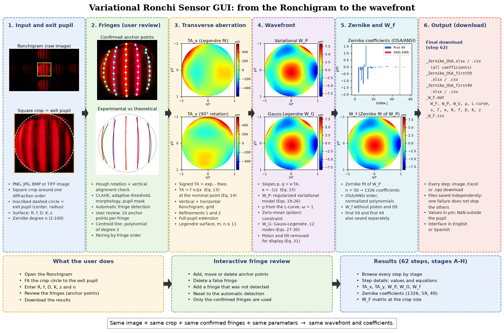
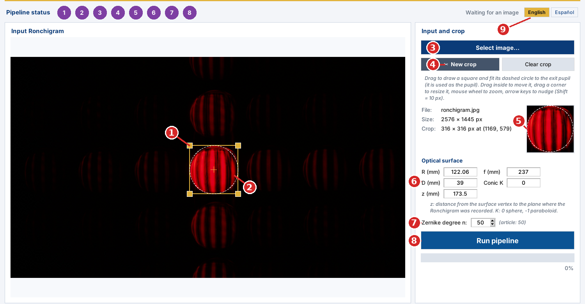
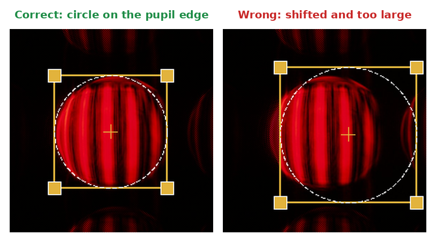
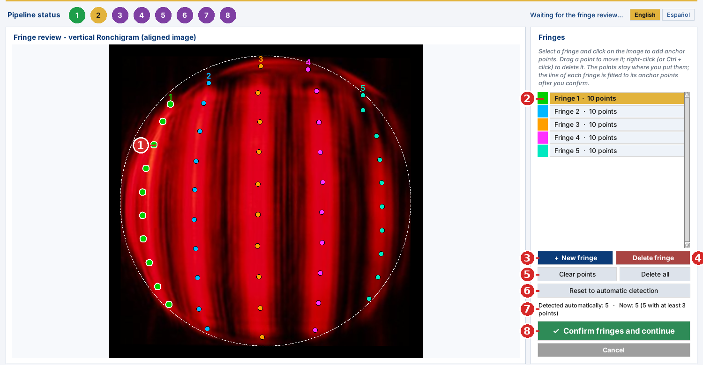
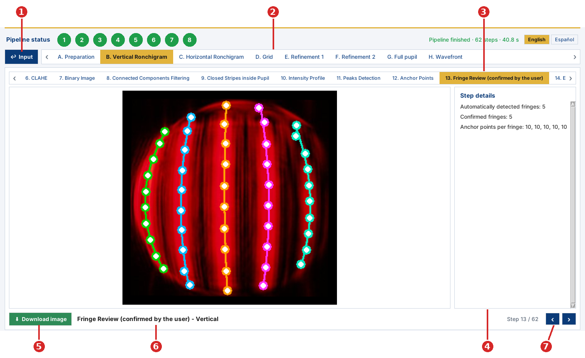
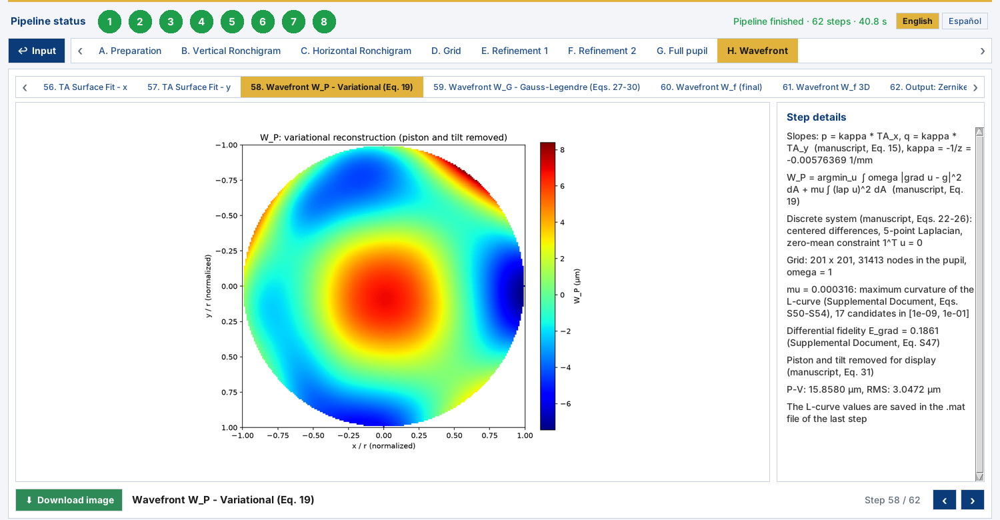

# Variational Ronchi Sensor

**English** | [Español](README.es.md)

A graphical application for processing Ronchigrams, estimating transverse aberrations, reconstructing the optical wavefront, and exporting Zernike coefficients and full-pupil wavefront matrices.

The software implements the computational pipeline described in the accompanying paper. It provides an interactive workflow for selecting the exit pupil, detecting and reviewing fringes, comparing experimental and theoretical Ronchigrams, refining transverse-aberration point clouds, and reconstructing the wavefront through a regularized variational model and an OSA/ANSI-ordered Zernike fit.

> **Research software notice**  
> This repository contains software associated with a scientific publication. If you use it in academic work, please cite the paper and the software release. Add the final citation and DOI in the [Citation](#citation) section when they become available.

## Key features

- Desktop graphical user interface written in Python with Tkinter.
- Input support for PNG, JPEG, BMP, and TIFF Ronchigrams.
- Interactive square crop whose inscribed circle defines the exit pupil.
- Automatic selection and contrast normalization of the image channel carrying the fringes.
- Automatic fringe alignment: Hough transform followed by a check of the central fringes.
- Adaptive fringe segmentation for nonuniform pupil illumination.
- Automatic fringe detection from the peaks of the column profile.
- Interactive fringe review, including adding, moving, and deleting anchor points and fringes.
- Experimental-to-theoretical fringe correspondence by diffraction order.
- Transverse-aberration estimation in two orthogonal directions.
- Grid construction from experimental and theoretical centroid-line intersections.
- Two-stage interpolation and point-cloud refinement.
- Extension of the reconstructed quantities to the full exit pupil, with measured and extrapolated points explicitly identified.
- Wavefront reconstruction with a regularized variational model (`W_P`) and a complementary Gauss-Legendre path integration (`W_G`).
- Zernike fitting in OSA/ANSI order, with a user-selectable maximum degree from 2 to 100.
- Export of intermediate figures, tables, point clouds, matrices, Zernike coefficients, and wavefront products.
- Background processing so that the interface remains responsive during a run.

## Pipeline overview



*Workflow of the GUI, from the raw Ronchigram to the wavefront. The images and maps come from a run of the program on the Ronchigram shown in column 1. The user takes part in two places: the crop that defines the exit pupil (column 1) and the fringe review (column 2). Everything else is automatic.*

A complete run contains 62 processing and output steps grouped into eight stages:

| Stage | Steps | Main operation | Main result |
|---|---:|---|---|
| A. Preparation | 1-5 | Orientation, exit-pupil definition, and optical parameters | Vertically aligned Ronchigram centered on the pupil |
| B. Vertical Ronchigram | 6-19 | Segmentation, fringe detection and review, centroid lines, theoretical reference | Transverse aberration in x |
| C. Horizontal Ronchigram | 20-33 | Analysis after an exact 90-degree rotation | Transverse aberration in y |
| D. Grid | 34-38 | Intersections of both centroid-line families | Displacements dx and dy |
| E. Refinement 1 | 39-41 | First interpolation pass | Refined point clouds |
| F. Refinement 2 | 42-48 | Second interpolation pass | Dense point clouds |
| G. Full pupil | 49-55 | Extension beyond the measured region | Full-pupil transverse-aberration fields |
| H. Wavefront | 56-62 | Surface fitting, variational (`W_P`) and Gauss-Legendre (`W_G`) reconstruction, and Zernike decomposition | `W_P`, `W_G`, the fitted wavefront `W_f`, and Zernike coefficients |

## Requirements

### Supported environment

The application is designed primarily as a Windows desktop program. The Python source can also run on other systems that provide Tkinter and the required scientific Python packages.

Recommended setup:

- Python 3.10 or newer
- A working Tk installation
- At least 8 GB of RAM for typical images
- Additional memory and processing time for large crops or high Zernike degrees

### Python dependencies

The source code imports the following third-party packages:

- `numpy`
- `scipy`
- `pandas`
- `matplotlib`
- `opencv-python`
- `Pillow`
- `openpyxl` for Excel export

Tkinter is part of the standard Python distribution on Windows. On some Linux distributions it must be installed separately through the system package manager.

## Installation

### 1. Clone the repository

```bash
git clone https://github.com/<OWNER>/<REPOSITORY>.git
cd <REPOSITORY>
```

Replace `<OWNER>` and `<REPOSITORY>` with the final GitHub organization/user and repository name.

### 2. Create a virtual environment

On Windows PowerShell:

```powershell
python -m venv .venv
.\.venv\Scripts\Activate.ps1
```

On Linux or macOS:

```bash
python3 -m venv .venv
source .venv/bin/activate
```

### 3. Install the dependencies

```bash
python -m pip install --upgrade pip
python -m pip install numpy scipy pandas matplotlib opencv-python Pillow openpyxl
```

Alternatively, create a `requirements.txt` file containing:

```text
numpy
scipy
pandas
matplotlib
opencv-python
Pillow
openpyxl
```

and install it with:

```bash
python -m pip install -r requirements.txt
```

## Running the application

There are two ways to open the program.

**Windows executable.** Double-click `VariationalRonchiSensor.exe`. No Python installation is needed. The first start can take several seconds while the executable unpacks itself.

**Python source.** From the repository directory, run:

```bash
python Ronchi.py
```

The GUI optionally displays three institutional logos. They are kept in the `img` folder of the repository:

```text
img/UNAM.png
img/UASLPlogo.png
img/INAOE.jpg
```

The program looks for them in the `img` folder and also next to `Ronchi.py` (or next to the executable, or inside it when they are bundled with PyInstaller). If a logo file is missing, the application displays a placeholder and the scientific pipeline remains usable.

### Language

The interface is available in **English** and **Spanish**. Choose the language with the **English | Español** buttons at the right of the pipeline-status bar, or with the **Language** menu. The change is applied immediately, also while results are open. Plots are drawn when the pipeline runs, so they keep the language that was selected at that moment; run the pipeline again to redraw them in the other language. Exported files (Excel, CSV, MAT) always use English column and variable names.

## Quick start

1. Launch the program and select **Select image…** (or **File ▸ Open image…**).
2. Select **✂ New crop** and drag a square around the diffraction order to be analyzed.
3. Fit the dashed circle to the edge of the exit pupil. **The circle inscribed in the crop is the exit pupil**: its center and radius are used by every later step (see [The crop defines the exit pupil](#the-crop-defines-the-exit-pupil)).
4. Enter the optical-surface parameters:
   - radius of curvature, `R`;
   - focal length, `f`;
   - aperture diameter, `D`;
   - conic constant, `K`;
   - distance from the surface vertex to the Ronchigram plane, `z`;
   - maximum Zernike degree, `n`.
5. Select **Run pipeline** and confirm the crop.
6. In the fringe-review view, check that every fringe has been found and that its **anchor points** (10 per fringe) lie on the center of the fringe.
7. Add, move, or remove points and fringes when required, then select **✓ Confirm fringes and continue** (see [Fringe review](#fringe-review)).
8. Browse the results by stage and processing step.
9. Go to the last step (**62. Output: Zernike Coefficients and W_F**) and select **⬇ Download Zernike coefficients + W_F** to save the wavefront and its Zernike coefficients. The other steps can be downloaded as images, Excel tables, or NumPy matrices.

## Input data

### Accepted image formats

- PNG
- JPG/JPEG
- BMP
- TIFF

The image is loaded as an 8-bit RGB image. Processing is performed on copies, and the input file is not modified.

### The crop defines the exit pupil



*Input view. (1) Square crop with its corner handles. (2) Dashed circle inscribed in the crop: this is the exit pupil used by the whole pipeline. (3) Select the image. (4) Start a new crop. (5) Enlarged preview of the crop. (6) Optical-surface parameters. (7) Maximum Zernike degree. (8) Run the pipeline. (9) Language.*

**The crop is the most important input of the program, because the dashed circle inscribed in it is the exit pupil.** The center of the circle is the center of the pupil and its radius is the pupil radius. The program uses them to:

- center the working image and rotate it about the pupil center;
- mask everything outside the pupil;
- build the theoretical Ronchigram and set the scale in millimeters per pixel (pupil radius at the plane `z` divided by the pupil radius in pixels);
- normalize the pupil coordinates of the transverse aberration, `W_P`, `W_G`, and the Zernike polynomials;
- build the final `W_F` matrix, which has the size of the crop.

An error in the crop is therefore an error in the scale, in the theoretical reference, and in the Zernike coefficients.

**Why a user-defined pupil is an advantage.** When no crop is drawn, the program tries to find the pupil by itself (thresholding, morphological closing, and the convex hull of the largest bright region). This automatic detection can draw the circle wrongly: the edge of the pupil is often dim or blurred, the illumination is not uniform, the fringes cut the bright region into pieces, and neighboring diffraction orders can be merged with the pupil. With the crop, the user decides exactly where the pupil is, and the result does not depend on how well the edge can be detected in a particular image.



*Left: the dashed circle follows the edge of the pupil. Right: the crop is shifted and too large, so the circle does not match the pupil. Adjust the crop until the circle lies on the edge, as on the left.*

How to fit the crop:

1. Select **✂ New crop** and drag on the image to draw a square around the diffraction order (usually the brightest, central one).
2. Look at the dashed circle, not at the square. Make the circle touch the edge of the pupil all the way around.
3. Adjust it:
   - drag inside the square to move it;
   - drag a corner to resize it (the opposite corner stays fixed);
   - use the mouse wheel to enlarge or reduce it about its center;
   - use the arrow keys to move it one pixel at a time, and Shift + arrow keys to move it ten pixels at a time.
4. Check the enlarged preview at the right (number 5 in the figure above) and the crop size and position shown under **Crop**.
5. **Clear crop** removes the crop; **✂ New crop** lets you draw a new square even inside the current one.

When **Run pipeline** is selected, the program shows the position and size of the crop and asks for confirmation. Choose **No** to keep adjusting it. If no crop has been drawn, the program asks whether the full image should be processed with automatic pupil detection.

### Optical parameters

All dimensional surface parameters are entered in millimeters.

| Parameter | Meaning |
|---|---|
| `R` | Radius of curvature of the tested surface |
| `f` | Focal length |
| `D` | Aperture diameter |
| `K` | Conic constant, e.g. 0 for a sphere and -1 for a paraboloid |
| `z` | Distance from the surface vertex to the Ronchigram recording plane |
| `n` | Maximum Zernike radial degree, from 2 to 100 |

Before processing, the software verifies that the values define a valid surface and ray mapping. In particular, the inferred refractive index is `1 + R/f`, the conic must be defined across the full aperture, and the recording plane must not lie inside the caustic.

The default parameters in the current source are:

```text
R = 122.06 mm
f = 237.0 mm
D = 39.0 mm
K = 0.0
z = 173.5 mm
Zernike degree = 50
```

These defaults are experiment-specific examples and should be replaced with the parameters of the surface and acquisition geometry being analyzed.

## Fringe review

**The whole pipeline depends on the fringes being correct.** The centroid lines, the comparison with the theoretical Ronchigram, the transverse aberration, and finally the wavefront are all computed from the fringes. For this reason, after the automatic detection the program stops and shows a **manual fringe review**, and **the rest of the pipeline runs only on the fringes confirmed by the user**.

The automatic detection is optimized to find the fringes as well as possible without help: it selects the image channel with the highest contrast, enhances it (CLAHE), applies an adaptive threshold that tolerates nonuniform illumination, removes small fragments, and locates the fringes from the peaks of the column profile. Even so, in some images it can fail, for example:

- a **false fringe**: a bright fragment near the pupil edge, a reflection, or noise detected as a fringe;
- a **missing fringe**: a dim, narrow, or partially cut fringe that was not detected;
- **misplaced points**: anchor points that leave the center of the fringe, usually near the pupil edge where the fringes are cut.

The review lets you correct all of these cases before anything else is computed.



*Fringe-review view. (1) Anchor points: the dots on each fringe, 10 per fringe, in the color of the fringe. (2) List of fringes with their number of points; the selected fringe is highlighted. (3) **+ New fringe**. (4) **Delete fringe**. (5) **Clear points** of the selected fringe and **Delete all** fringes. (6) **Reset to automatic detection**. (7) Counter: fringes detected automatically, fringes now, and how many have enough points. (8) **✓ Confirm fringes and continue**.*

### What the anchor points are

Each detected fringe is represented by **10 anchor points** placed on its center line: the fringe is divided into 10 horizontal bands, and in each band the anchor point is the center of mass of the white pixels of the fringe. The anchor points are the **reference used to trace the fringe**: after the review, a polynomial of **degree 2** is fitted to the anchor points of each fringe, and that curve is the **centroid line** of the fringe. The centroid line is then sampled every 5 px and compared point by point with the corresponding theoretical line.

The points stay exactly where they are placed; the curve is fitted only after the fringes are confirmed. Because the curve passes through the points in the least-squares sense, the points must lie on the center of the fringe along its whole length.

### Correcting the fringes

| To do this | Do this |
|---|---|
| Select a fringe | Click it in the list, or click near one of its points on the image. |
| Add a point to the selected fringe | Click on the center of the fringe on the image. The points are sorted from top to bottom automatically. |
| Move a point | Drag it with the mouse. |
| Delete a point | Right-click it (or Ctrl + click). |
| Delete a **false fringe** | Select it and press **Delete fringe**. |
| Add a fringe that **was not detected** | Press **+ New fringe** and click along the center of the fringe on the image, from top to bottom, adding at least 3 points. Points spread along the whole fringe give a better curve. |
| Redraw the points of a fringe | Select it, press **Clear points**, and click the new points. |
| Start again from scratch | **Delete all**, then add the fringes with **+ New fringe**. |
| Undo all the changes | **Reset to automatic detection**. |

More points or fewer points can be used per fringe: the 10 automatic points are only the starting point. Add points where the fringe bends or where the automatic points are sparse; remove points that are off the fringe. A fringe needs **at least 3 points** (the minimum for a degree-2 curve); a warning sign (⚠) appears in the list when a fringe has fewer. **At least 2 fringes** are needed to continue.

When the fringes are correct, select **✓ Confirm fringes and continue**. **Cancel** stops the pipeline so that the crop or the parameters can be changed.

The review is done once, on the vertical Ronchigram. The horizontal Ronchigram (stage C) is the same image rotated 90 degrees about the pupil center, so the confirmed fringes are reused there automatically.

After the run, step **13. Fringe Review (confirmed by the user)** shows the confirmed points, and step **14. Experimental Centroid Lines** shows the fitted curves.

## Browsing the results



*Results view. (1) **↩ Input** returns to the input view to change the crop or the parameters. (2) Stages A-H. (3) Steps of the selected stage. (4) Step details: values, settings, and equations of the step. (5) Download the current step. (6) Title of the step. (7) Step counter and previous/next buttons.*

- Select a stage (2) and then one of its steps (3), or move through all the steps with the arrows (7) or the left/right arrow keys.
- The eight circles of the pipeline-status bar show the state of each stage (purple: pending, gold: running, green: finished, red: failed). Click a circle to open that stage.
- The download button (5) saves the current step: images as PNG or JPEG; the summary steps (18, 32, and 37) as Excel workbooks with the compared points; the two **Output** steps of stages F and G as an Excel workbook (three sheets) plus a `.npz` file with the matrices; and the last step as the wavefront products.

Useful steps to check the quality of a run:

| Step | What to check |
|---|---|
| 4. Exit Pupil and Centering | The white circle must coincide with the pupil. |
| 13. Fringe Review (confirmed by the user) | The anchor points that were used. |
| 14. Experimental Centroid Lines | Each curve follows the center of its fringe. |
| 17. Experimental vs Theoretical Correspondence | Each experimental line is paired with the right theoretical line. |
| 56-57. TA Surface Fit | Smooth transverse-aberration surfaces without spikes at the edge. |
| 58-59. `W_P` and `W_G` | Both reconstructions should look alike. |

## Obtaining the wavefront

Stage **H. Wavefront** contains the result:

| Step | Content |
|---|---|
| 56. TA Surface Fit - x | Continuous transverse aberration `TA_x` (µm) |
| 57. TA Surface Fit - y | Continuous transverse aberration `TA_y` (µm) |
| 58. Wavefront W_P - Variational (Eq. 19) | Principal reconstruction `W_P`, without piston and tilt |
| 59. Wavefront W_G - Gauss-Legendre (Eqs. 27-30) | Complementary reconstruction `W_G`, without piston and tilt |
| 60. Wavefront W_f (final) | Zernike fit of `W_P`, without piston and tilt |
| 61. Wavefront W_f 3D | The same `W_f` as a 3D surface |
| 62. Output: Zernike Coefficients and W_F | Summary and final download |



*Step 58: variational wavefront `W_P`. The step details give the slope calibration, the selected regularization parameter `μ`, and the P-V and RMS values.*

To save the wavefront:

1. Go to step **62. Output: Zernike Coefficients and W_F**.
2. Select **⬇ Download Zernike coefficients + W_F**.
3. Choose a folder and a base name. All the files are written with that base name (see [Final wavefront products](#final-wavefront-products)).
4. Wait until the message **Saved** appears. `W_F` is computed at this moment on the full crop size, so it can take a while; the progress is shown in the status line at the bottom of the window.

Each file is written independently. If one of them cannot be written (for example, a file with the same name is open in Excel, or the folder is read-only), the others are still saved, and the message **Saved with errors** lists which file failed and why.

## Method summary

### Orientation and resampling

The program first estimates the fringe orientation with a Hough transform (median angle of the detected line segments) and rotates the image so that the fringes are vertical. It then checks the residual inclination of the three central fringes, using a straight line fitted to their anchor points, and corrects it until it is below 0.3 degrees or three correction iterations have been completed. The image is then centered on the exit pupil in a square working frame.

### Segmentation and fringe detection

The fringe channel is selected automatically as the RGB channel with the largest standard deviation. Its intensities are stretched between the 1st and 99.7th percentiles. Segmentation then applies CLAHE, Gaussian smoothing, adaptive thresholding, connected-component filtering, morphological closing, and the pupil mask.

The fringes are detected from the peaks of the smoothed column profile of the binary image. Peaks much closer to a neighbor than the median spacing are treated as fragments, and only the stronger one is kept. Each fringe receives 10 anchor points, one per horizontal band, which are then reviewed by the user.

### Centroid lines and transverse aberration

A polynomial of degree 2 is fitted to the confirmed anchor points of each fringe and sampled every 5 px inside the pupil; this is the centroid line.

Experimental centroid lines are matched to theoretical lines by fringe order relative to the central fringe. The theoretical Ronchigram is built by exact ray tracing through the surface (`R`, `f`, `D`, `K`) to the plane `z`, with the same spacing and stripe width as the experimental Ronchigram. Signed transverse aberrations are calculated as experimental minus theoretical positions at corresponding rows, and each value is located at the nominal (theoretical) point of the fringe (manuscript, Eq. 14). They are converted to millimeters as `TA = Γ·s·Δx` (manuscript, Eq. 13), with `Γ = 1` and `s` the pixel size at the plane `z` (pupil radius at `z` from the ray tracing divided by the pupil radius in pixels).

The horizontal Ronchigram is the vertical one rotated 90 degrees about the pupil center; it gives the transverse aberration in the orthogonal direction.

### Refinement and full-pupil extension

The measured point clouds undergo two interpolation passes. The first requests five inserted points between neighboring lines, and the second requests ten. The applied number is reduced when necessary to keep refined samples at least one pixel apart.

Values outside the measured region are extrapolated to the full pupil with a fourth-degree polynomial plus a decaying nearest-data residual. Exported full-pupil tables label each point as `data` or `extended` so that measured/refined values can be distinguished from extrapolated values.

### Wavefront reconstruction

The signed transverse-aberration components are fitted with continuous surfaces made of products of Legendre polynomials `P_m(x) P_n(y)`, `m, n ≤ 11` (manuscript, Sec. 5B; Supplemental Document, Eq. S18). The slopes of the wavefront are `p = κ·TA_x` and `q = κ·TA_y`, with `κ = -1/z` (manuscript, Eq. 15).

- **`W_P` (principal):** regularized variational reconstruction (manuscript, Eqs. 19-26) on a 201 × 201 Cartesian grid of the unit pupil, with centered differences, a five-point Laplacian, uniform confidence weights (`ω = 1`), and a zero-mean (piston) constraint. The regularization parameter `μ` is selected automatically at the maximum curvature of the L-curve among 17 values from `1e-9` to `1e-1` (Supplemental Document, Eqs. S50-S54).
- **`W_G` (complementary):** line integral of the slopes along straight paths from the pupil center, evaluated with 12 Gauss-Legendre nodes (manuscript, Eqs. 27-30).

Both are given in micrometers. Piston and tilt are removed for display (manuscript, Eq. 31). `W_P` is fitted with normalized Zernike polynomials in OSA/ANSI order; the fitted wavefront `W_f` is shown without piston and tilt, and the exported data retain the full coefficient set.

## Outputs

### Per-step downloads

Depending on the selected step, the GUI can export:

- PNG or JPEG images;
- Excel workbooks containing summaries or point clouds;
- `.npz` archives containing difference matrices.

### Final wavefront products

The final export writes eight files using the selected base name:

```text
<name>_Zernike_OSA.xlsx
<name>_Zernike_OSA.csv
<name>_Zernike_OSA_first59.xlsx
<name>_Zernike_OSA_first59.csv
<name>_Zernike_OSA_first49.xlsx
<name>_Zernike_OSA_first49.csv
<name>_W_F.mat
<name>_W_F.csv
```

The Zernike tables contain:

- OSA/ANSI index `j` (starting at `j = 0`, piston);
- radial degree `n`;
- azimuthal order `m`;
- fitted coefficient in micrometers.

`_Zernike_OSA` contains all the coefficients (1326 for `n = 50`); `_first59` and `_first49` contain the first 59 and the first 49 coefficients in the same order. They are taken from the complete fit; because the polynomials are orthonormal, a fit with only those modes would give practically the same values.

The MATLAB file contains:

- `W_F`: full Zernike-fitted wavefront on the crop grid;
- `W_F_without_piston_tilt`;
- `W_P_interpolated` and `W_G_interpolated`: the variational and Gauss-Legendre wavefronts on the crop grid;
- Zernike coefficients and their `(n, m)` indices, and the Zernike degree;
- fit-point count and fit RMS;
- the regularization parameter `mu` and the L-curve (`lcurve_mu`, `lcurve_R`, `lcurve_S`);
- the calibration constants `s_mm_per_px`, `Gamma`, and `kappa_per_mm`;
- optical parameters and units.

`_W_F.csv` contains the `W_F` matrix only.

Wavefront values are in micrometers. Pixels outside the pupil are stored as `NaN`.

> Computing and exporting the full-resolution `W_F` matrix can take substantially longer than the main GUI run, especially for large image crops and high Zernike degrees.

## Main numerical settings

The following values are defined as constants near the beginning of `Ronchi.py` and can be adjusted for controlled experiments:

| Setting | Default |
|---|---:|
| Alignment tolerance | 0.3 degrees |
| Maximum alignment iterations | 3 |
| Central fringes used for the alignment check | 3 |
| Adaptive-threshold window | 25% of image size |
| Adaptive-threshold offset | 20 gray levels above the local mean |
| Minimum connected-component area | 300 px |
| Morphological closing | 10 x 10 px |
| Anchor points per fringe | 10 |
| Minimum anchor points per fringe in the review | 3 |
| Centroid-line degree | 2 |
| Sampling interval along a centroid line | 5 px |
| Refinement passes | 5 and 10 inserted points |
| Minimum refined-point spacing | 1 px |
| Full-pupil extension polynomial degree | 4 |
| TA surface-fit degree per variable | 11 |
| Pupil grid for `W_P` and `W_G` | 201 x 201 |
| Confidence weight `ω` | 1 |
| Candidate values of `μ` (L-curve) | 17, from `1e-9` to `1e-1` |
| Gauss-Legendre nodes | 12 |
| Default maximum Zernike degree | 50 |
| Terms removed for display | piston and tilt |

## Limitations

1. The method is designed for a grating that produces a family of vertical fringes after alignment. The orthogonal transverse-aberration component is inferred from an exact 90-degree rotation of the same Ronchigram, which assumes the rotational symmetry required by the method.
2. When a manual crop is used, the pupil center and radius are only as accurate as the fitted inscribed circle.
3. Values in the extended region near the pupil boundary are extrapolated rather than measured. Use the `source` column in exported tables to distinguish them.
4. Very compressed, closed, merged, low-contrast, or partially visible fringes may require manual correction during fringe review.
5. Processing time and memory use increase with image dimensions and maximum Zernike degree.
6. The optical parameters and acquisition geometry must be physically consistent. Invalid surfaces, caustic crossings, or a pupil collapsed at focus are rejected before processing.

## Suggested repository structure

```text
.
├── Ronchi.py
├── README.md
├── README.es.md
├── requirements.txt
├── LICENSE
├── CITATION.cff
├── img/
│   ├── UNAM.png
│   ├── UASLPlogo.png
│   └── INAOE.jpg
├── docs/
│   ├── images/
│   └── Supplemental_GUI_Document.pdf
└── examples/
    ├── input/
    └── output/
```

The logos in `img/` are found automatically by `Ronchi.py`. When building the executable, bundle them with PyInstaller (`--add-data`) so that they are shown by the `.exe`.

## Windows executable

A Windows executable can be distributed separately from the Python source, for example through the GitHub **Releases** page. The executable should be built from a tagged commit so that users can identify the corresponding source version.

If institutional logos are bundled with PyInstaller, include them as data files and retain their expected names. Example commands are intentionally not fixed here because the appropriate separator and packaging options may vary by operating system and release process.

## Reproducibility recommendations

For scientific use, record the following with every analysis:

- software version or Git commit;
- input image name and checksum;
- crop coordinates and pupil radius;
- `R`, `f`, `D`, `K`, and `z`;
- selected Zernike degree;
- any manual changes made during fringe review;
- exported full-pupil point tables, including the `source` column;
- Zernike coefficients and fitted wavefront matrices.

A tagged release and an archived copy in a research repository are recommended for the version associated with the paper.

## Citation

Please replace this placeholder with the citation of the associated paper:

```bibtex
@article{AUTHOR_YEAR_VARIATIONAL_RONCHI,
  author  = {Author list},
  title   = {Paper title},
  journal = {Journal name},
  year    = {Year},
  volume  = {Volume},
  pages   = {Pages},
  doi     = {DOI}
}
```

If the software receives a DOI, add a separate software citation and a `CITATION.cff` file.

## License

No license information was provided with the current source. Before publishing the repository, add a `LICENSE` file and replace this section with the selected license and any institutional requirements.

Without an explicit license, others may view the public repository but do not automatically receive permission to copy, modify, or redistribute the software.

## Authors and contact

Add the final author list, institutional affiliations, and a contact address here.

```text
Corresponding authors: Jesús Alonso Arriaga Hernández^1, Bolivia Cuevas Otahola^2
Email: dr.j.a.arriaga.hernandez@gmail.com, bcuevas@astro.unam.mx
Institution:
1. FCFM, BUAP
2. Instituto de Astronomía, UNAM
```

## Acknowledgments

The authors thank Instituto de Astronomía UNAM and Instituto Nacional de Astrofísica, Óptica y Electrónica for the support given during this research work.

## Disclaimer

This software is intended for research use. Users are responsible for validating the acquisition geometry, optical parameters, fringe selection, and reconstructed quantities for their experimental configuration. Scientific conclusions should not rely on the automatically detected fringes without reviewing the anchor points and the intermediate diagnostic products.
